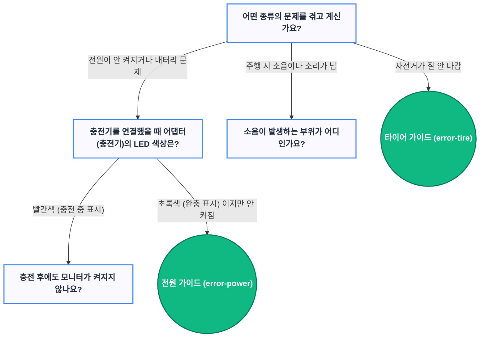

# 전기자전거 웹 매뉴얼 관리 가이드 (CMS 통합 버전)

이 프로젝트는 누구나 쉽게 새로운 매뉴얼을 추가하고 관리할 수 있도록 설계되었습니다. 
코딩을 잘 모르시더라도 구글 스프레드시트와 GitHub 웹사이트만 있으면 100% 관리가 가능합니다.

---

## 📌 빠른 링크 (Quick Links)
깃허브(GitHub) 메인 페이지에서는 현재 보고 계신 `README.md` 파일만 자동으로 열립니다. 
다른 핵심 문서들을 보시려면 아래 링크를 클릭해 주세요!

* 🛠️ **[관리자용 마크다운 종합 예시 (admin.md)](./src/data/markdown/admin.md)** : 표, 다이어그램, 알림 박스 등 웹페이지에 적용되는 모든 시각적 마크다운 예시 모음
* 📝 **[마크다운 기본 문법 가이드 (MARKDOWN_GUIDE.md)](./MARKDOWN_GUIDE.md)** : 글씨 굵게, 링크, 리스트, 빠른 연결 버튼(CTA), 동영상 삽입 등 기본적인 마크다운 작성법
* 🆕 **[업데이트 패치 노트 (PATCH_NOTES.md)](./PATCH_NOTES.md)** : 시스템 개선 및 기능 추가 내역
* 📜 **[README 히스토리 (readme_history.md)](./readme_history.md)** : 본 가이드 문서의 수정 내역

---

## 🚀 실시간으로 수정 내용 확인하기 (라이브 뷰 - 초보자용)

내 컴퓨터(IDE)에서 수정한 내용을 실시간으로 확인하려면 아래 명령어를 사용하세요.

### 📝 실행 방법:
1. VS Code 하단 터미널(Terminal)창을 엽니다. (단축키: `Ctrl + `` `)
2. 아래 명령어를 입력하고 엔터를 누릅니다.
   ```bash
   npm run dev
   ```
3. 터미널에 뜨는 주소(예: `http://localhost:5173/`)를 `Ctrl + 클릭` 하거나 브라우저에 입력하면 실시간 화면이 열립니다.
   * **팁**: 코드를 수정하고 저장(`Ctrl + S`)하면 브라우저 화면이 자동으로 새로고침되어 반영됩니다!

---

## 📂 1. 좌측 메뉴판 & 카테고리 관리 (Google Sheets)
좌측에 보이는 네비게이션 메뉴와 통합 검색용 요약 데이터는 구글 스프레드시트에서 중앙 관리됩니다.

* **관리용 구글 스프레드시트 주소:**
  [Xtron Manual CMS 접속하기](https://docs.google.com/spreadsheets/d/e/2PACX-1vQLeyv9lic0ituxpPWhCvEfqnkEpttZn9GbGMIBtZGjErqYvKkzirEN2hVW-Q7Wy8rXQVzpcQcHTqwG/edit?usp=sharing) (관리자 권한 필요)

### 🚀 메뉴 수정 및 추가 방법 (스프레드시트 구조):

스프레드시트의 각 행(Row)은 화면에 표시될 **하나의 개별 가이드 항목**을 나타냅니다.

| 열 이름 (Column) | 설명 | 작성 예시 |
| :--- | :--- | :--- |
| **CategoryID** | 대분류를 식별하는 고유 영문 ID | `battery-guide` |
| **CategoryTitle** | 화면에 표시될 대분류 이름 | `배터리 가이드` |
| **SubCategoryID** | 중분류를 식별하는 고유 영문 ID | `battery-removal` |
| **SubCategoryTitle** | 화면에 표시될 중분류 이름 | `배터리 탈착` |
| **ChildCategoryID** | **[선택]** 소분류를 식별하는 고유 영문 ID (없을 경우 빈칸) | `seatpost` |
| **ChildCategoryTitle** | **[선택]** 화면에 표시될 소분류 이름 (없을 경우 빈칸) | `싯포스트형` |
| **ItemID** | 개별 가이드를 식별하는 고유 영문 ID | `battery-seatpost` |
| **ItemTitle** | 화면에 표시될 개별 가이드 제목 | `ㄴ 싯포스트 배터리 탈착` |
| **IconName** | 사용할 lucide-react 아이콘 이름 ([전체 목록 보기](https://lucide.dev/icons)) | `Key` |
| **Summary** | 검색 시 나타날 요약 설명 (여러 줄일 경우 `\|` 구분자 사용) | `싯포스트 일체형...` |
| **MarkdownFile** | 연결될 마크다운 문서 파일명 (예: `kickstand-TypeA.md` 또는 `parts/kickstand-TypeA.md`. 파일명만 적어도 자동 연결됨) | `kickstand-TypeA.md` |
| **YoutubeLink** | (선택) 영상이 있는 경우 유튜브 주소 입력 | `https://youtu.be/...` (없으면 빈칸) |
| **Status** | **[선택]** 배포 상태 제어 (`Deploy`: 실서버 및 테스트 서버 모두 노출, `BranchDeploy`: 테스트/로컬 서버만 노출, 빈칸: 기본값 `BranchDeploy` 적용, `Hide`: 숨김) | `Deploy` |

#### 📝 작성 예시 데이터:
| CategoryID | CategoryTitle | SubCategoryID | SubCategoryTitle | ChildCategoryID | ChildCategoryTitle | ItemID | ItemTitle | Icon | Summary | MarkdownFile | YoutubeLink | Status |
| :--- | :--- | :--- | :--- | :--- | :--- | :--- | :--- | :--- | :--- | :--- | :--- | :--- |
| battery-guide | 배터리 가이드 | battery-removal | 배터리 탈착 | seatpost | 싯포스트형 | battery-seatpost | ㄴ 싯포스트 배터리 탈착 | Key | 싯포스트 일체형... | battery/battery-seatpost.md | | Deploy |
| basic | 기본 가이드 | basic-assembly | 조립 및 피팅 | | | pedal | 페달 장착 방법 | Wrench | 좌/우 페달 식별... | basic/pedal.md | https://youtu.be/... | Deploy |

> **💡 스프레드시트 작성 팁 (3단계 vs 4단계 구조 및 직통 링크)**
> - **소분류 생략 (3단계)**: 소분류가 필요 없는 일반 항목은 `ChildCategoryID`와 `ChildCategoryTitle`을 **빈칸**으로 두시면, 기존처럼 3단계(중분류 바로 아래 아이템)로 렌더링됩니다.
> - **폴더 생략 (직통 링크)**: '설명서 다운로드'처럼 하위 폴더 없이 클릭 시 바로 본문으로 이동하게 하려면, **`SubCategoryTitle`과 `ChildCategoryTitle`을 모두 빈칸으로** 두세요. 빈 폴더 없이 깔끔한 직통 링크 버튼으로 생성됩니다!

> **🎨 IconName 작성 가이드**
> [lucide.dev/icons](https://lucide.dev/icons)에서 원하는 아이콘을 검색한 뒤 **PascalCase** 이름을 그대로 입력합니다. 잘못된 이름이나 빈칸일 경우 자동으로 `HelpCircle`(❓) 아이콘이 표시됩니다.
>
> **현재 사용 중인 아이콘 목록:**
> `Wrench` · `BatteryCharging` · `AlertTriangle` · `Wind` · `ZapOff` · `Settings` · `MonitorPlay` · `ShieldAlert` · `VolumeX` · `Power` · `Activity` · `PersonStanding` · `Gauge` · `Lightbulb` · `ArrowLeftRight` · `Navigation` · `Key` · `Zap` · `CheckCircle`

---

### 🤖 자가진단 마법사 관리 (Google Sheets 2번 탭 - WizardFlow)
증상별 문답을 통해 문제를 해결하는 '자가진단 마법사' 데이터는 구글 스프레드시트의 2번째 탭(`WizardFlow`)에서 관리됩니다.

#### 📝 2번 탭 구조 및 열 설명:
| 열 이름 (Column) | 설명 | 작성 예시 |
| :--- | :--- | :--- |
| **RowID** | 개별 선택지 식별용 ID (선택) | `OPT-001` |
| **NodeID** | 현재 질문 노드 ID (최초 시작 화면은 반드시 `start`) | `start`, `power_sub_1` |
| **Question** | 해당 노드에서 사용자에게 던질 질문 텍스트 | `어떤 종류의 문제를 겪고 계신가요?` |
| **OptionLabel** | 사용자가 클릭할 선택지 버튼 문구 | `전원이 안 켜지거나 배터리 문제` |
| **Keywords** | 검색 및 추천용 보조 키워드 | `전원, 충전, 배터리` |
| **NextNodeID** | 선택 시 이동할 다음 질문 노드 ID (최종 해결 단계일 경우 빈칸) | `power_sub_1` |
| **ResultItemID** | 최종 해결 가이드로 연결될 가이드 ItemID (다음 질문이 있을 경우 빈칸) | `lcd-display-replacement` |
| **Status** | 노출 여부 제어 (`Deploy`: 실서버 및 로컬 노출, `BranchDeploy`: 로컬/테스트 서버만 노출, `Hide`: 숨김) | `Deploy` |

> **💡 마법사 버튼 자동 노출 규칙:**
> - 2번 탭의 시작 노드(`NodeID: start`)에 배포 상태(`Deploy` 또는 테스트 환경의 `BranchDeploy`)를 만족하는 선택지가 **1개 이상 존재할 때만** 사이드바(좌측 패널) 및 메인 홈에 '자가진단 마법사' 버튼이 자동으로 표시됩니다.
> - 시작 옵션이 모두 `Hide` 처리되거나 비활성화되면 마법사 버튼도 UI에서 자동으로 숨겨집니다.

---

### 💬 자주 묻는 질문 관리 (Google Sheets 3번 탭 - FAQ)
별도의 마크다운(`.md`) 파일을 생성할 필요 없이, 짧은 질문과 간단한 해결 가이드는 구글 스프레드시트의 3번째 탭(`FAQ`)에서 통합 관리됩니다.

#### 📝 3번 탭 구조 및 열 설명:
| 열 이름 (Column) | 설명 | 작성 예시 |
| :--- | :--- | :--- |
| **FAQ_ID** | 개별 질문을 식별하는 고유 ID (검색 및 마법사 `ResultItemID` 연결용) | `FAQ-001` |
| **Category** | FAQ 페이지 상단 분류 필터 탭 이름 | `배터리/충전`, `조립/부품` |
| **Question** | 화면에 표시될 질문 제목 | `완충까지 시간이 얼마나 걸리나요?` |
| **Answer** | 펼쳐졌을 때 나타날 답변 (`Alt+Enter` 줄바꿈, `**굵게**`, R2 이미지/동영상 마크다운 지원) | `완전 방전 기준 **약 4~5시간** 소요됩니다.` |
| **Keywords** | 통합 검색 및 FAQ 검색에 걸리게 할 보조 유의어 (쉼표 구분) | `충전시간, 완충, 초록불, 어댑터` |
| **RelatedItemID** | **[선택]** 답변 하단에 `[관련 매뉴얼 보러가기]` 버튼으로 연결할 1번 탭의 `ItemID` | `battery-charging` |
| **Pinned** | **[선택]** 상단 고정 및 메인 홈 `'자주 찾는 질문'` 태그 자동 노출 여부 (`TRUE` / `FALSE`) | `TRUE` |
| **Status** | 노출 여부 제어 (`Deploy`: 실서버 및 로컬 노출, `BranchDeploy`: 로컬/테스트 서버만 노출, `Hide`: 숨김) | `BranchDeploy` |

> **💡 FAQ 자동 연동 특징:**
> - **사이드바 버튼 자동 노출**: 3번 탭에 유효한 배포 상태의 질문이 **1개 이상 존재할 때만** 좌측 사이드바 상단에 `'자주 묻는 질문 (FAQ)'` 버튼이 자동으로 나타납니다.
> - **자가진단 마법사 연동**: 2번 탭(`WizardFlow`)의 `ResultItemID` 칸에 `FAQ-001`처럼 `FAQ_ID`를 입력하면, 마법사 최종 결과에서 해당 FAQ 답변이 즉시 펼쳐지며 이동합니다.
> - **핵심 질문(`Pinned`) 자동 추천**: `Pinned`가 `TRUE`인 항목은 FAQ 목록 최상단에 `'📌 핵심'` 뱃지와 함께 우선 배치되며, 메인 홈 화면의 추천 질문 태그로 자동 표시됩니다.

### 🛠️ 데이터 연결 및 반영 방법:

스프레드시트에 입력된 데이터는 내부적으로 **`src/data/guides.jsx`** 형태의 중첩된 그룹 구조(Nested JSON)로 변환되어 사용됩니다.

1. **웹 브라우저 자동 연동 (캐싱 시스템 적용)**: 구글 스프레드시트 서버의 과부하(Rate Limit)를 방지하고 사용자의 웹페이지 로딩 속도를 극대화하기 위해 **5분 단위의 브라우저 캐싱(Session Storage)**이 적용되어 있습니다. 
   * **반영 시간:** 스프레드시트에서 내용을 수정한 뒤, 사용자가 사이트에 접속(또는 새로고침)하면 **최대 5분 안**에 자동으로 업데이트된 내용이 반영됩니다.
   * **즉시 확인:** 캐시가 만료되기 전 즉시 확인하고 싶다면 브라우저의 새 탭이나 시크릿 창을 열어 접속하시면 바로 확인 가능합니다.
2. **수동 코드 반영 (로컬 개발 시)**: 오프라인이나 로컬 코드 위주로 작업하신다면, 스프레드시트의 내용을 바탕으로 `src/data/guides.jsx` 파일에 직접 위 데이터 구조에 맞게 코드를 추가해 주시면 됩니다.

---

## 📝 2. 본문 내용 작성 및 수정 (GitHub Markdown)
가이드 본문의 상세한 텍스트와 사진은 GitHub 저장소에 보관된 **마크다운(.md)** 파일들로 관리됩니다.

### 🚀 내용 수정하는 방법:
1. GitHub 저장소로 이동합니다. (`src/data/markdown/` 폴더)
   👉 [저장소 마크다운 폴더 바로가기](https://github.com/Rinology/xtron-manual/tree/main/src/data/markdown)
2. 수정하고 싶은 파일(예: `pedal.md`)을 클릭하여 엽니다.
3. 우측 상단의 **✏️ (연필 모양 버튼)**을 누릅니다.
4. 구글 문서처럼 자유롭게 글을 쓰고 사진 링크를 넣습니다.
5. 작성을 완료한 후 우측 상단의 초록색 **[Commit changes...]** 버튼을 누르면 즉시 실서버(Vercel)에 배포가 시작됩니다. (약 1분 뒤 반영)

### 🌟 새로운 마크다운(새 가이드 본문) 추가하기 (초보자용 GitHub 가이드):
1. GitHub 저장소의 `src/data/markdown/` 폴더로 이동합니다.
2. 우측 상단에 있는 **[Add file]** 버튼을 클릭하고 **[Create new file]**을 선택합니다.
3. 파일 이름 입력칸에 원하는 영어 이름과 함께 `.md` 확장자를 붙여 적어줍니다. (예: `new-guide.md`)
4. 아래쪽 넓은 편집창에 마크다운 문법으로 원하는 내용을 자유롭게 작성합니다.
5. 작성이 끝나면 우측 상단의 초록색 **[Commit changes...]** 버튼을 누르고, 다시 나타나는 창에서 초록색 버튼을 한 번 더 누르면 파일이 저장됩니다.
6. 마지막으로, 방금 만든 파일의 이름(`new-guide.md`)을 구글 스프레드시트의 `MarkdownFile` 열에 똑같이 적어주시면 홈페이지와 완벽하게 연결됩니다!
   * **💡 꿀팁:** `basic`, `battery` 등 하위 폴더에 파일을 분류해 넣었더라도 스프레드시트에는 폴더 경로 없이 **파일명만(`new-guide.md`)** 적으시면 시스템이 똑똑하게 알아서 찾아줍니다!

> [!IMPORTANT]
> **스프레드시트 목차 등록 시 주의사항!**
> 1. **목차 등록 필수:** GitHub에 `.md` 파일을 작성했다면 반드시 구글 스프레드시트(목차)에 행을 추가해 파일명을 등록해야 홈페이지 메뉴에 나타납니다.
> 2. **⚠️ 파일명 중복 주의:** 시스템이 파일명만으로 전체 폴더를 뒤져서 알아서 문서를 찾아오기 때문에, 다른 폴더에 있더라도 **마크다운 파일명은 절대 중복되지 않게 고유한 이름**으로 지어주셔야 오류가 발생하지 않습니다!

> [!TIP]
> **🚀 깃허브 충돌(Conflict) 방지를 위한 꿀팁 (작업 영역 분리)**
> 브랜치(Branch)나 PR(Pull Request) 같은 복잡한 깃허브 기능 없이도, 여러 명이 충돌(에러) 없이 안전하게 동시 작업하는 가장 확실한 방법은 **'작업 영역을 완벽하게 나누는 것'**입니다.
> - **👨‍💻 개발자 (로컬 IDE 사용):** 사이트 기능과 뼈대가 되는 `src/components`, `src/utils` 등의 '코드 파일'만 수정합니다.
> - **📝 콘텐츠 작성자 (웹사이트 사용):** 매뉴얼 본문이 들어있는 `src/data/markdown` 안의 **`.md` 파일들만 수정**합니다.
> 
> 서로 수정하는 '폴더와 파일'이 겹치지만 않는다면, 복잡한 절차 없이 웹에서 곧바로 초록색 **[Commit changes]** 버튼을 눌러도 충돌 없이 알아서 병합(Merge)되어 사이트에 반영됩니다!

---

## 📸 3. 마크다운 자동 디자인 및 기본 문법

단순한 텍스트로 작성된 마크다운(.md) 파일이 웹페이지에서 깔끔하게 보이는 이유는 시스템(`GuideContent.jsx`)이 텍스트를 읽고 미리 지정된 브랜드 디자인을 **자동으로 덧입혀주기 때문**입니다. 작성자는 디자인을 신경 쓸 필요 없이 내용에만 집중하시면 됩니다!

### 🎨 자동 적용되는 스타일 및 문법

* **제목 달기 (Heading)**: `#` 기호를 씁니다.
  ```markdown
  ### 이것은 소제목입니다
  #### 이것은 더 작은 제목입니다
  ```
  👉 **결과:** 폰트 크기가 커지고, 브랜드 컬러(파란색)와 여백 및 하단 테두리가 자동으로 예쁘게 적용됩니다.

* **인용문 및 경고 박스 (Blockquote)**: `>` 기호를 씁니다.
  ```markdown
  > [!CAUTION]
  > **안전 안내 사항**
  > 반드시 전원을 차단하고 배터리를 분리하십시오.
  ```
  👉 **결과:** 좌측에 굵은 파란색 테두리가 생기고, 옅은 배경색이 깔린 예쁜 알림/경고 박스 형태로 디자인됩니다.

* **사진 및 동영상 넣기 (Cloudflare R2 연동 & GIF 대체 최적화)**: 
  사진(`.webp`, `.jpg` 등)뿐만 아니라 **동영상(`.mp4`, `.webm`)**도 기존 이미지와 동일한 마크다운 문법으로 편하게 삽입할 수 있습니다.
  
  ```markdown
  <!-- 1. 사진 삽입 (R2 대시보드의 경로 그대로 복사하여 입력 가능) -->
  
  <!-- 또는 상대 경로 / 풀 URL 모두 완벽 지원 -->
  

  <!-- 2. 동영상 삽입 (GIF 대체용 MP4) -->
  
  <!-- 또는 R2 풀 URL 사용 -->
  
  ```

  👉 **GIF 대신 MP4 동영상을 써야 하는 이유 (용량 & 속도 최적화):**
  - GIF는 압축률이 낮아 몇 초 분량도 수십 MB에 달하며 모바일 로딩 속도를 크게 저하시킵니다.
  - 동일한 화면을 **MP4/WebM으로 변환하여 올리면 용량이 80~90% 이상 절감**됩니다.
  - 시스템이 동영상 확장자(`.mp4`, `.webm` 등)를 스스로 감지하여, 브라우저에서 GIF처럼 **자동 무한 반복 재생(`autoPlay`, `loop`, `muted`, `playsInline`)**되는 **프리미엄 전용 비디오 플레이어(`VideoPlayer.jsx`)**로 자동 변환 렌더링해 줍니다.
  - **스마트 제어 버튼 세트 기본 탑재**:
    - ⏯️ **재생 / 일시정지 (Play / Pause)**: 화면 터치 또는 하단 버튼으로 언제든 멈추고 다시 볼 수 있습니다.
    - 🔁 **반복재생 토글 (Loop ON / OFF)**: 기본값은 편안한 무한 반복이며, 텍스트 정독 시 시선 분산을 막고 싶다면 버튼 하나로 1회 재생 모드로 전환할 수 있습니다.
    - 🔄 **처음부터 다시보기 (Replay)**: 원클릭으로 0초로 즉시 되감아 다시 확인할 수 있습니다.
    - ⏱️ **타임라인 탐색(Scrubber) & 전체화면(Fullscreen)**: 원하는 초 단위로 자유롭게 이동하거나 세밀한 조립 과정을 확대해 볼 수 있습니다.

  👉 **미디어 자동 최적화 규격:**
  모든 이미지와 동영상은 화면 렌더링 시 **가로 최대 600px, 세로 최대 600px**로 자동 제한됩니다. 아무리 해상도가 높거나 세로로 긴 미디어를 넣어도 화면을 벗어나지 않고 **원본 비율을 유지하며 안전하게 축소**되므로 사이즈를 억지로 맞춰서 올리실 필요가 없습니다. (추가로 모서리가 8px 둥글게 깎이고 깔끔한 테두리가 적용됩니다.)

  ### ⚡ Cloudflare R2 + 커스텀 도메인 연동 아키텍처 (비용 및 속도 최적화)
  정적 미디어(이미지, MP4 동영상, PDF 설명서)는 Cloudflare R2에 저장되고, 커스텀 도메인(`https://cdn.xtron-guide.kr`) 및 에지 캐시(Cache-Control) 룰을 통해 초고속으로 전송됩니다.
  
  #### 📊 데이터 흐름 다이어그램
  ```mermaid
  sequenceDiagram
      participant User as 👤 사용자 브라우저
      participant Vercel as 🌐 Vercel (프론트엔드)
      participant CF as ⚡ Cloudflare Edge CDN (캐시 서버)
      participant R2 as 🪣 Cloudflare R2 (미디어 저장소)

      Note over User, Vercel: [1단계] 웹사이트 최초 접속
      User->>Vercel: 웹사이트 접속 (xtron-manual)
      Vercel-->>User: 레이아웃, 코드 전달 (빠름)

      Note over User, R2: [2단계] 첫 번째 미디어 요청 (최초 1회)
      User->>CF: 사진/영상/PDF 요청 (cdn.xtron-guide.kr)
      CF->>R2: (캐시에 없음) R2야 파일 전달해줘!
      R2-->>CF: 파일 전달 (Egress 다운로드 비용 0원 무료!)
      CF-->>User: 사용자에게 전달 및 글로벌 에지 캐시에 저장

      Note over User, R2: [3단계] 이후 방문 또는 다른 사용자의 접속
      User->>CF: 동일 미디어 요청
      CF-->>User: R2 버킷 접근 없이 에지 캐시에서 초고속 전달!
      
      Note right of CF: ✨ Egress 트래픽 비용 0원 유지 <br> ✨ 글로벌 캐시로 응답 속도 극대화
  ```
  
  * **비용 절감 원리:** Cloudflare R2는 AWS S3와 달리 **아웃바운드 다운로드 트래픽(Egress) 요금이 완전히 무료**입니다. 대용량 MP4 영상이나 PDF 설명서를 수만 명이 다운로드해도 트래픽 추가 비용이 발생하지 않습니다.
  * **도메인 통일:** 모든 이미지, MP4, PDF는 단일 커스텀 도메인인 **`https://cdn.xtron-guide.kr`**로 일원화되어 서비스됩니다.

* **유튜브 영상 버튼 넣기**: 
  메뉴 데이터(구글 스프레드시트) 쪽에 `youtubeLink` 같은 별도 항목을 두어 버튼화하는 것도 가능하며, 마크다운 본문에도 직접 링크를 적어주면 작동합니다.

* **강조 및 목록**:
  ```markdown
  **이 글씨는 굵게 나옵니다**
  * 항목 1
  * 항목 2
  ```
  👉 **결과:** 줄 간격이 넓고 가독성 좋은 부드러운 회색 톤(`lineHeight: 1.6`)으로 렌더링됩니다.

---

## 🤖 4. 자가진단 마법사 봇 질문 수정 (스프레드시트 연동)

메인 화면에 뜨는 챗봇 스타일의 '상황별 자가진단 마법사' 질문 흐름은 구글 스프레드시트의 **`WizardFlow`** 탭에서 전적으로 관리됩니다. 

구글 AppSheet와의 완벽한 호환성과 확장성을 모두 고려하여, **"1행 = 1개의 선택지(버튼)"** 형식의 데이터베이스(DB) 정규화 모델로 설계되어 있습니다.

### 📊 자가진단 마법사 스프레드시트 구조 (WizardFlow 탭)

| 열 이름 (Column) | 설명 | AppSheet 역할 |
| :--- | :--- | :--- |
| **RowID** | **[필수]** 각 행을 식별하는 고유 ID (예: `OPT-001`, `OPT-002`). | `Key` 컬럼 (Primary Key) |
| **NodeID** | 질문의 묶음(화면)을 식별하는 ID (예: `start`, `power_1`). 이 값이 같은 행들은 하나의 화면(질문)에 나오는 버튼들로 묶입니다. | `Group By` 기준 컬럼 |
| **Question** | 화면 최상단에 띄울 질문 내용입니다. (동일한 `NodeID` 안에서는 같은 질문을 복사해 넣습니다.) | 화면 제목 텍스트 |
| **OptionLabel** | 사용자가 누르게 될 선택지 버튼의 텍스트입니다. | 버튼 텍스트 |
| **NextNodeID** | 버튼을 눌렀을 때 이어질 다음 질문의 `NodeID`입니다. (가이드로 바로 넘어갈 경우 비워둡니다.) | 다음 화면 라우팅 |
| **ResultItemID** | 버튼을 눌렀을 때 연결할 최종 가이드의 `ItemID`입니다. (기존 가이드 시트의 ItemID와 동일. 다음 질문이 있을 경우 비워둡니다.) | 최종 결과(URL) 매핑 |
| **Keywords** | (선택사항) 초기 `start` 화면에서 사용자가 검색할 때 걸리게 할 보조 키워드(유의어)들을 쉼표로 구분해 넣습니다. (예: `충전불가, 배터리 부족, 방전`) | 검색 보조 키워드 |

> **💡 ResultItemID의 역할은 무엇인가요?**
> `ResultItemID`는 스무고개의 **최종 정답지**를 의미합니다. 예를 들어 사용자가 선택지를 누르다가 이 값에 `error-tire`가 적혀 있다면, 마법사는 즉시 "이 문제를 해결하려면 '타이어 공기압' 가이드를 보세요!" 라고 판단하여 `troubleshooting/error-tire.md` 문서로 화면을 자동 이동시켜 줍니다.

#### 📝 실제 데이터 입력 예시 (Keywords 활용)

| RowID | NodeID | Question | OptionLabel | Keywords | NextNodeID | ResultItemID |
| :--- | :--- | :--- | :--- | :--- | :--- | :--- |
| OPT-001 | `start` | 어떤 종류의 문제를 겪고 계신가요? | 전원이 안 켜지거나 배터리 문제 | `방전, 충전불가, 켜지지않음` | `power_sub_1` | |
| OPT-002 | `start` | 어떤 종류의 문제를 겪고 계신가요? | 주행 시 소음이나 소리가 남 | `소리, 끽끽, 딸깍` | `noise_sub_1` | |
| OPT-003 | `start` | 어떤 종류의 문제를 겪고 계신가요? | 자전거가 잘 안 나감 (주행감 저하) | `무거움, 타이어, 바람, 펑크` | | `error-tire` |
| OPT-004 | `power_sub_1` | 충전 시 어댑터의 LED 색상은 무엇인가요? | 빨간색 (충전 중 표시) | | `power_sub_2` | |
| OPT-005 | `power_sub_1` | 충전 시 어댑터의 LED 색상은 무엇인가요? | 초록색 (완충 표시) 이지만 안 켜짐 | | | `error-power` |

### 🧠 동작 원리 및 시각화 (흐름도)

자가진단 마법사는 위 표를 바탕으로, 사용자가 겪고 있는 문제를 단계별로 좁혀나가 최종적으로 **가장 적합한 가이드 문서(MD)**를 매칭해 주는 시스템입니다.



 